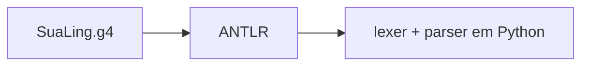
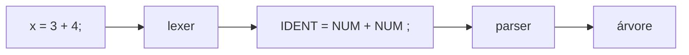

# ANTLR 4: Como pensar e escrever gramáticas
*Linguagens Formais e Compiladores*

---

## 1. O que o ANTLR é

ANTLR significa **ANother Tool for Language Recognition**. Ele recebe a descrição de uma linguagem e gera o código que a reconhece.



Você escreve **um arquivo**, com extensão `.g4`, e ele produz as classes que fazem a análise. Não é preciso escrever o autômato nem a pilha à mão.

Ele gera código para Java, Python, C#, JavaScript, Go e outras linguagens. Aqui usamos Python.

---

## 2. A ideia central: duas camadas num arquivo

Um arquivo `.g4` contém dois tipos de regra, e o ANTLR distingue os dois pela **primeira letra do nome**.

| Nome | É regra de | Roda em | Classe |
| :--- | :--- | :--- | :--- |
| `NUMERO`, `IDENT` | lexer | autômato finito | regular |
| `expr`, `instrucao` | parser | pilha | livre de contexto |

> [!IMPORTANT]
> **A CAIXA DA LETRA DIZ A MÁQUINA**  
> Regra em **MAIÚSCULA** vira autômato finito, e por isso não pode ser recursiva. Regra em **minúscula** vira código com pilha, e por isso pode chamar a si mesma. É a mesma divisão entre as duas primeiras fases do compilador.

### 2.1 O que cada camada faz

O **lexer** lê caractere por caractere e agrupa em tokens. O **parser** recebe os tokens e monta a estrutura.



---

## 3. Escrevendo regras de lexer

São expressões regulares, com sintaxe própria.

### 3.1 Os operadores

| Escreve-se | Significa | Exemplo |
| :--- | :--- | :--- |
| `'abc'` | exatamente esse texto | `'se'` |
| `[abc]` | um dos caracteres listados | `[+\-*/]` |
| `[a-z]` | qualquer da faixa | `[0-9]` |
| `~[abc]` | qualquer exceto os listados | `~['\n]` |
| `*` | zero ou mais vezes | `[0-9]*` |
| `+` | uma ou mais vezes | `[0-9]+` |
| `?` | zero ou uma vez | `'='?` |
| `\|` | ou | `'sim' \| 'nao'` |
| `.` | qualquer caractere | |
| `.*?` | qualquer coisa, o mínimo possível | |

São os mesmos operadores das expressões regulares do encontro 4, com uma notação um pouco diferente.

### 3.2 As regras que toda linguagem precisa

```antlr
// identificador: letra ou sublinhado, depois letras, digitos ou sublinhado
IDENT : [a-zA-Z_] [a-zA-Z_0-9]* ;

// numeros
REAL : [0-9]+ '.' [0-9]+ ;
INTEIRO : [0-9]+ ;

// texto entre aspas, sem quebra de linha dentro
TEXTO : '"' ~["\r\n]* '"' ;

// comentario de linha
COMENT : '//' ~[\r\n]* -> skip ;

// comentario de bloco
BLOCO : '/*' .*? '*/' -> skip ;

// espaco em branco
ESPACO : [ \t\r\n]+ -> skip ;
```

### 3.3 O `-> skip`

Ele diz: **reconheça isto e jogue fora**. O token existe para o lexer saber onde termina, mas não é entregue ao parser.

É como se descarta espaço em branco e comentário. Sem o `skip`, o parser teria de tratar espaços em toda regra.

---

## 4. As três armadilhas do lexer

### 4.1 Ordem das regras

Quando duas regras casam com o mesmo texto, **vence a que aparece primeiro no arquivo**.

```antlr
// ERRADO
IDENT : [a-z]+ ;
SE : 'se' ;
```
Aqui a palavra `se` vira `IDENT`, porque `IDENT` veio antes. A regra `SE` nunca dispara.

```antlr
// CERTO
SE : 'se' ;
IDENT : [a-z]+ ;
```

> [!WARNING]
> **PALAVRAS-CHAVE SEMPRE ANTES DE IDENTIFICADOR**  
> Toda palavra-chave da sua linguagem precisa ser declarada **antes** da regra de identificador. Se não for, ela será reconhecida como um nome de variável qualquer.

### 4.2 Casamento mais longo

Antes de olhar a ordem, o ANTLR aplica outra regra: **entre dois casamentos possíveis, ele prefere o mais longo**.

Com a entrada `3.14` e as regras `INTEIRO` e `REAL`, ele reconhece `REAL` mesmo que `INTEIRO` venha antes — porque `3.14` é mais longo que `3`.

> [!NOTE]
> **A ORDEM SÓ DECIDE EMPATES**  
> Primeiro o ANTLR busca o casamento mais longo. A ordem no arquivo só é consultada quando duas regras casam com exatamente o mesmo trecho. É o caso das palavras-chave contra identificador: `se` tem dois caracteres nas duas regras.

### 4.3 Regra de lexer não pode ser recursiva

```antlr
// ISTO NAO FUNCIONA
PARENTESES : '(' PARENTESES ')' | ;
```

Regra de lexer vira autômato finito, e autômato finito não tem pilha. Aninhamento é assunto do parser.

---

## 5. Escrevendo regras de parser

São escritas em minúsculas, e podem chamar outras regras, inclusive a si mesmas.

```antlr
programa : instrucao+ EOF ;

instrucao : IDENT '=' expr ';'
          | 'imprime' expr ';'
          ;

expr : expr ('*'|'/') expr
     | expr ('+'|'-') expr
     | '(' expr ')'
     | NUMERO
     | IDENT
     ;
```

### 5.1 Como se lê

| Símbolo | Significa |
| :---: | :--- |
| `:` | "é definido como" |
| `\|` | "ou" |
| `;` | fim da regra |
| `+` | uma ou mais vezes |
| `*` | zero ou mais vezes |
| `?` | opcional |
| `EOF` | fim do arquivo |

A regra `programa` lê-se: *um programa é uma ou mais instruções, seguidas do fim do arquivo.*

### 5.2 Precedência sai da ordem das alternativas

Na regra `expr`, a multiplicação aparece **antes** da soma. Isso faz o ANTLR ligar mais forte a multiplicação, e `2 + 3 * 4` é lido como `2 + (3 * 4)`.

> [!CAUTION]
> **A ORDEM DAS ALTERNATIVAS DEFINE A PRECEDÊNCIA**  
> Se você trocar as duas primeiras linhas de `expr`, a soma passa a ligar mais forte e a conta muda de resultado. É a fonte mais comum de erro silencioso.

### 5.3 Literais podem ficar no meio da regra

Repare que `'='`, `';'` e `'imprime'` aparecem direto na regra de parser, sem token declarado. O ANTLR cria tokens anônimos para eles automaticamente.

Funciona, e é conveniente para símbolos. Para palavras-chave, prefira declarar o token, porque isso deixa o nome visível na árvore e na mensagem de erro.

---

## 6. Rodando

### 6.1 Instalação

```bash
pip install antlr4-tools antlr4-python3-runtime
```

O primeiro pacote cria os comandos `antlr4` e `antlr4-parse`, que baixam o Java automaticamente na primeira execução. O segundo é a biblioteca que o código gerado usa.

### 6.2 Testando sem gerar código

Este é o comando mais útil enquanto você escreve a gramática:

```bash
antlr4-parse SuaLing.g4 programa -tokens
```

Ele lê da entrada padrão e mostra os tokens reconhecidos, sem gerar arquivo nenhum. Encerre a entrada com `Ctrl+D` (no Linux/macOS) ou `Ctrl+Z` seguido de Enter (no Windows).

> [!TIP]
> **USE ISSO DESDE O PRIMEIRO DIA**  
> Escrever a gramática inteira antes de testar é a receita para não achar o erro. Teste cada regra de lexer assim que escrever.

### 6.3 Gerando o código

```bash
antlr4 -Dlanguage=Python3 -visitor -o gerado gramatica/SuaLing.g4
```

| Opção | O que faz |
| :--- | :--- |
| `-Dlanguage=Python3` | gera Python em vez de Java |
| `-visitor` | gera também a classe de visita da árvore |
| `-o gerado` | põe a saída no diretório `gerado` |

O `-visitor` só será necessário na E4, mas não custa gerar desde já.

### 6.4 Usando no Python

```python
from antlr4 import FileStream, CommonTokenStream
from SuaLingLexer import SuaLingLexer

entrada = FileStream('exemplos/ola.ml', encoding='utf-8')
lexer = SuaLingLexer(entrada)
fluxo = CommonTokenStream(lexer)
fluxo.fill()

for t in fluxo.tokens:
    print(lexer.symbolicNames[t.type], repr(t.text), t.line)
```

---

## 7. Erros comuns

| Sintoma | Causa provável |
| :--- | :--- |
| palavra-chave vira `IDENT` | a regra da palavra-chave está depois de `IDENT` |
| `ModuleNotFoundError` no import do lexer | o diretório `gerado/` não está no `sys.path`, ou o script de geração não rodou |
| conta dá resultado errado | ordem das alternativas em `expr` inverteu a precedência |
| o parser reclama de espaço | faltou `-> skip` na regra `ESPACO` |
| erro estranho de versão | a versão do `.jar` não bate com a do `antlr4-python3-runtime` |
| regra de lexer nunca dispara | outra regra anterior casa com o mesmo texto |

---

## 8. Onde aprender mais

- **Guia oficial de início:**  
  [https://github.com/antlr/antlr4/blob/master/doc/getting-started.md](https://github.com/antlr/antlr4/blob/master/doc/getting-started.md)
- **Documentação completa:**  
  [https://github.com/antlr/antlr4/tree/master/doc](https://github.com/antlr/antlr4/tree/master/doc)
- **Tutorial extenso, com exemplos em Python:**  
  [https://tomassetti.me/antlr-mega-tutorial/](https://tomassetti.me/antlr-mega-tutorial/)
- **Tutorial em português:**  
  [https://gabrielvaleze16.medium.com/tutorial-do-antlr-v4-cc4eb6d9c1ba](https://gabrielvaleze16.medium.com/tutorial-do-antlr-v4-cc4eb6d9c1ba)

> A documentação em português é escassa. O material do Tomassetti é o melhor para aprender, e começa exatamente pelo lexer antes de tratar o parser.

