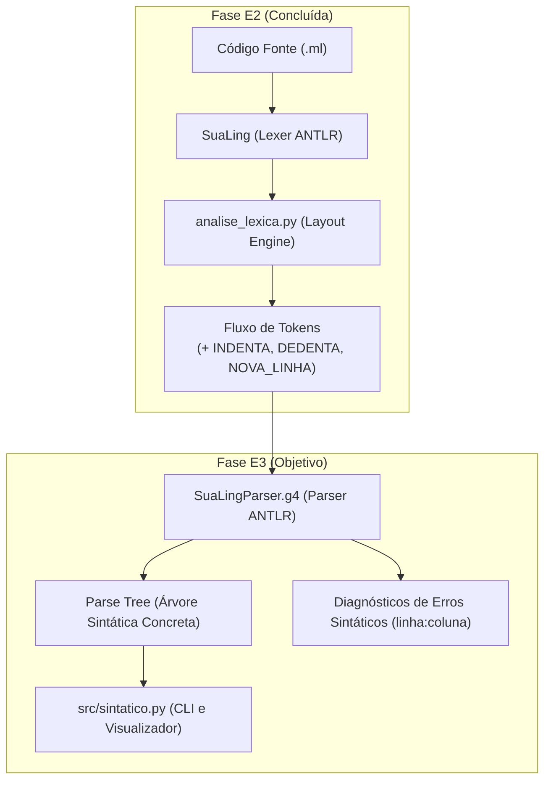

# Especificação Técnica — Etapa E3: Analisador Sintático e Árvore Sintática
**Projeto Procedural RPG — Linguagens Formais e Compiladores**

---

## 1. Visão Geral e Objetivos da E3

A **E3** constitui a segunda fase do compilador da linguagem **Procedural RPG**, avançando da análise de caracteres e tokens (*Léxica - E2*) para o reconhecimento de estruturas gramaticais e hierarquia sintática (*Sintática - E3*).



### Objetivos Principais
1. **Definição da Gramática Livre de Contexto**: Mapear todas as construções definidas na [especificacao.md](especificacao.md) em regras de parser ANTLR 4 (`parser grammar`).
2. **Consumo de Tokens com Indentação Estruturada**: Integrar o parser diretamente ao pipeline da E2, consumindo os tokens virtuais `INDENTA`, `DEDENTA` e `NOVA_LINHA` sem necessidade de tratamento de espaços pelo parser.
3. **Construção e Navegação da Árvore Sintática**: Habilitar a geração do *Visitor* (`-visitor`) para permitir que fases futuras (E4 - semântica e interpretador) percorram a árvore sintática.
4. **Localização Precisa de Erros Sintáticos**: Fornecer mensagens de erro legíveis com linha e coluna para sentenças incompletas, símbolos inesperados ou estruturas fora de ordem.
5. **Visualizador de Árvore e Testes Automatizados**: Criar o utilitário de linha de comando `src/sintatico.py` e cobrir tanto casos válidos quanto inválidos sintáticos.

---

## 2. Decisão Arquitetural: Gramáticas Separadas

Para manter o princípio da responsabilidade única e não comprometer os 25 testes da E2:

* **`gramatica/SuaLing.g4` (Lexer)**: Permanece como `lexer grammar SuaLing;`, focado unicamente no reconhecimento de tokens léxicos e descarte de espaços/comentários.
* **`gramatica/SuaLingParser.g4` (Parser)**: Declarado como `parser grammar SuaLingParser;`, importando o vocabulário gerado pelo lexer através de:
  ```antlr
  parser grammar SuaLingParser;
  options { tokenVocab = SuaLing; }
  ```

### Por que essa separação é ideal?
1. **Preservação do pipeline de layout**: O arquivo `src/analise_lexica.py` continua injetando `INDENTA`, `DEDENTA` e `NOVA_LINHA` entre o lexer e o parser.
2. **Gramática do parser puramente declarativa**: O parser não lida com espaços em branco brutos; blocos são simplesmente pares `INDENTA ... DEDENTA`.
3. **Isolamento de testes**: Se a gramática do parser for alterada, os testes léxicos continuam isolados e estáveis.

---

## 3. Mapeamento Gramatical Completo (Regras de Parser)

Abaixo estão as regras sintáticas que cobrem integralmente o documento de especificação da linguagem.

### 3.1. Programa e Nível Superior

Um programa em Procedural RPG consiste em linhas vazias opcionais, uma sequência de instruções/declarações de entidades e termina obrigatoriamente com o comando `iniciar`:

```antlr
programa
    : nova_linha* (instrucao_topo nova_linha*)* comando_iniciar nova_linha* EOF
    ;

nova_linha
    : NOVA_LINHA
    ;
```

### 3.2. Expressões (`expr`) e Tabela Estrita de Precedência

A especificação define 8 níveis de precedência (do mais forte para o mais fraco). No ANTLR 4, a ordem em que as alternativas aparecem na regra define diretamente sua precedência:

```antlr
expr
    // Nível 1: Chamada de método/construtor e acesso a membro (esquerda para direita)
    : expr ABRE_PAREN lista_argumentos? FECHA_PAREN       # ExprChamada
    | expr PONTO IDENT                                     # ExprAcessoMembro

    // Nível 2: Operadores unários (+ e -)
    | (MAIS | MENOS) expr                                  # ExprUnaria

    // Nível 3: Multiplicação e Divisão (esquerda para direita)
    | expr (MULTIPLICACAO | DIVISAO) expr                  # ExprMultiplicativa

    // Nível 4: Adição, Subtração e Concatenação de texto
    | expr (MAIS | MENOS) expr                             # ExprAditiva

    // Nível 5: Comparações relacionais e igualdade
    | expr op_relacional expr                              # ExprRelacional

    // Nível 6: Negação booleana
    | NAO expr                                             # ExprNao

    // Nível 7: Conjunção booleana (e)
    | expr E expr                                          # ExprE

    // Nível 8: Disjunção booleana (ou)
    | expr OU expr                                         # ExprOu

    // Primários / Termos básicos
    | ABRE_PAREN expr FECHA_PAREN                          # ExprParenteses
    | literal                                              # ExprLiteral
    | IDENT                                                # ExprIdentificador
    ;

op_relacional
    : MENOR | MENOR_IGUAL | MAIOR | MAIOR_IGUAL | IGUAL | DIFERENTE
    ;

literal
    : INTEIRO
    | REAL
    | TEXTO
    | VERDADEIRO
    | FALSO
    ;

lista_argumentos
    : expr (VIRGULA expr)*
    ;
```

### 3.3. Blocos Indentados

A hierarquia da linguagem é definida por blocos que utilizam a indentação obrigatória calculada pela etapa de layout:

```antlr
bloco_entidade
    : INDENTA (membro_entidade nova_linha*)+ DEDENTA
    ;

bloco_instrucoes
    : INDENTA (instrucao_operacao nova_linha*)+ DEDENTA
    ;
```

### 3.4. Instruções de Nível Superior e Declarações de Entidade

No nível de topo ou dentro de um bloco de entidade, temos:
1. Instanciação de entidades (`var = Pai.tipo("id")` ou `var = Universo("id")`).
2. Configuração de atributos básicos (`nome = "..."`).
3. Declaração/atualização de campos de estado/ficha (`tipo objeto.estado.campo = valor`).
4. Critérios de marcos e encerramento (`concluir ... quando ...`, `encerrar ... quando ...`).
5. Declaração de operações narrativas (`operacao historia.nome`).

```antlr
instrucao_topo
    : declaracao_entidade
    | declaracao_estado
    | atribuicao_simples
    | chamada_metodo_avulsa
    ;

declaracao_entidade
    : IDENT ATRIBUICAO chamada_criacao bloco_entidade?
    ;

chamada_criacao
    : IDENT ABRE_PAREN lista_argumentos? FECHA_PAREN
    | expr PONTO IDENT ABRE_PAREN lista_argumentos? FECHA_PAREN
    ;

membro_entidade
    : declaracao_entidade
    | atribuicao_propriedade
    | declaracao_estado
    | chamada_metodo_avulsa
    | regra_conclusao_marco
    | regra_encerramento_historia
    | declaracao_operacao
    ;

atribuicao_propriedade
    : IDENT ATRIBUICAO expr
    ;

declaracao_estado
    : tipo_dado caminho_estado ATRIBUICAO expr
    ;

tipo_dado
    : TIPO_INTEIRO | TIPO_REAL | TIPO_TEXTO | TIPO_BOOLEANO
    ;

caminho_estado
    : IDENT PONTO (IDENT PONTO)* IDENT
    ;

chamada_metodo_avulsa
    : expr PONTO IDENT ABRE_PAREN lista_argumentos? FECHA_PAREN
    ;
```

### 3.5. Regras de Progresso e Marcos

```antlr
regra_conclusao_marco
    : CONCLUIR IDENT QUANDO expr
    ;

regra_encerramento_historia
    : ENCERRAR IDENT QUANDO expr
    ;
```

### 3.6. Declaração de Operações Narrativas e Comandos de Operação

As operações declaram comportamento controlado na história. O primeiro comando do bloco é sempre `requer`:

```antlr
declaracao_operacao
    : OPERACAO caminho_estado bloco_operacao
    ;

bloco_operacao
    : INDENTA clausula_requer nova_linha* (instrucao_operacao nova_linha*)+ DEDENTA
    ;

clausula_requer
    : REQUER expr
    ;

instrucao_operacao
    : atribuicao_estado
    | comando_narrar
    | comando_se
    ;

atribuicao_estado
    : caminho_estado ATRIBUICAO expr
    ;

comando_narrar
    : NARRAR expr
    ;

comando_se
    : SE expr bloco_instrucoes (SENAO bloco_instrucoes)?
    ;
```

### 3.7. Comando de Abertura de Sessão

O programa termina obrigatoriamente com a abertura da sessão:

```antlr
comando_iniciar
    : INICIAR expr COM expr
    ;
```

---

## 4. O Analisador Sintático (`src/sintatico.py`)

O CLI sintático integrará o pipeline completo:

```python
# Arquitetura conceitual do src/sintatico.py
def analisar_sintaxe(caminho_arquivo: Path):
    # 1. Carrega o texto fonte
    texto = caminho_arquivo.read_text(encoding="utf-8-sig")

    # 2. Executa Lexer + Layout da E2
    resultado_lexico = analisar(texto)
    if resultado_lexico.erros:
        # Se houver erros léxicos, exibe e encerra com código 1
        return 1

    # 3. Alimenta o parser ANTLR com o fluxo de tokens sintetizados
    stream = CommonTokenStream(TokenSourceList(resultado_lexico.tokens))
    parser = SuaLingParser(stream)
    parser.removeErrorListeners()
    parser.addErrorListener(SintaticoErrorListener())

    # 4. Constrói a árvore a partir da regra raiz 'programa'
    arvore = parser.programa()
    
    # 5. Verifica se houve erros sintáticos
    if listener.erros:
        imprimir_erros(listener.erros)
        return 1

    return 0, arvore
```

### Modos de Saída do CLI:
* `python src/sintatico.py exemplos/ola.ml`: Valida a sintaxe e reporta se o programa é válido.
* `python src/sintatico.py --arvore exemplos/ola.ml`: Imprime a árvore sintática concreta (formato identado ou S-expression LISP-like).
* Código de saída:
  * `0`: Sucesso sintático.
  * `1`: Erro sintático ou léxico encontrado (com linha e coluna).
  * `2`: Falha de arquivo ou argumentos.

---

## 5. Casos de Teste da E3

### 5.1. Testes de Programas Válidos
Todos os programas válidos da E2 devem ser analisados sem nenhum erro sintático:
- `exemplos/ola.ml`
- `exemplos/quadrado.ml`
- `exemplos/espiral.ml`
- `exemplos/parte_a.ml`

### 5.2. Novos Testes de Programas Inválidos (Erros Sintáticos)
Serão criados arquivos na pasta `invalidos_sintaticos/` cobrindo falhas gramaticais clássicas:

| Arquivo de Teste | Erro Sintático Avaliado |
|---|---|
| `parenteses_sem_fechar.ml` | Expressão com `(` sem o correspondente `)`. |
| `se_sem_condicao.ml` | Palavra-chave `se` sem uma expressão booleana válida. |
| `operacao_sem_requer.ml` | Bloco `operacao` cujo primeiro comando não é `requer`. |
| `iniciar_fora_de_posicao.ml` | Comando `iniciar` colocado no meio do arquivo ao invés do final. |
| `expressao_com_operador_duplo.ml` | Expressão inválida como `x = 2 + * 3`. |

### 5.3. Testes Automatizados de Precedência da Árvore
Testes unitários automatizados inspecionando os nós da árvore para garantir que:
- Em `2 + 3 * 4`, o nó pai seja `+` e o nó filho direito seja `3 * 4`.
- Em `nao a e b`, a negação se aplique apenas a `a` antes do `e`.

---

## 6. Roteiro Passo a Passo de Construção e Aprendizado

| Passo | Meta de Aprendizado | Tarefa Prática |
| :---: | :--- | :--- |
| **Passo 1** | Como o ANTLR conecta lexer e parser via `tokenVocab` | Configurar `SuaLingParser.g4` e atualizar scripts de geração (`gerar.sh` / `gerar.ps1`). |
| **Passo 2** | Precedência de operadores sem regras intermediárias | Escrever a regra `expr` completa com rótulos `# NomeAlternativa`. |
| **Passo 3** | Instruções simples e blocos de indentação | Criar regras para declarações de campos, `narrar`, atribuições e blocos `INDENTA`/`DEDENTA`. |
| **Passo 4** | Entidades, operações narrativas e início de sessão | Escrever a estrutura de `Universo`, `Historia`, `Marco`, `operacao` e `iniciar`. |
| **Passo 5** | Interligação e Listener de Erros | Implementar `src/sintatico.py` consumindo os tokens do layout da E2. |
| **Passo 6** | Validação com suíte de testes | Rodar testes nos exemplos válidos, criar os inválidos sintáticos e validar a árvore. |
