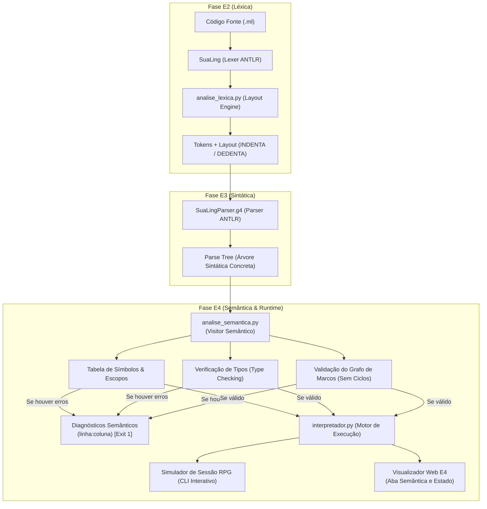
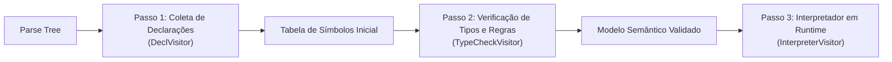

# Especificação Técnica — Etapa E4: Análise Semântica, Verificação de Tipos e Execução
**Projeto Procedural RPG — Linguagens Formais e Compiladores**

---

## 1. Visão Geral e Objetivos da E4

A **E4** é a terceira e última fase do compilador da linguagem **Procedural RPG**, consolidando o ciclo completo da disciplina de Linguagens Formais e Compiladores:
1. **E2 (Léxica):** Caracteres $\rightarrow$ Tokens e tratamento de indentação (*Concluída*).
2. **E3 (Sintática):** Fluxo de Tokens $\rightarrow$ Árvore Sintática Concreta (CST) (*Concluída*).
3. **E4 (Semântica & Runtime):** Árvore Sintática $\rightarrow$ Tabela de Símbolos, Verificação Estática de Tipos, Validação do Grafo Narrativo e Execução Interativa da Sessão (*Objetivo Atual*).



### Objetivos Principais
1. **Tabela de Símbolos e Resolução de Escopo**: Rastrear entidades, hierarquias de pertencimento e impedir o uso de referências e campos não declarados.
2. **Sistema e Verificação Estática de Tipos**: Garantir compatibilidade rigorosa de tipos (`inteiro`, `real`, `texto`, `booleano`) em expressões, atribuições, pré-requisitos (`requer`), narração e condicionais.
3. **Validação Estrutural do Domínio de RPG**: Validar regras semânticas complexas:
   - Métodos de criação permitidos por receptor (conforme Tabela 4.2 da especificação).
   - Unicidade e obrigatoriedade de regras de marcos (`concluir`) e de encerramento (`encerrar`).
   - Análise de Grafo: detecção de dependências cíclicas e auto-dependências entre marcos da mesma história.
   - Associação válida no comando `iniciar campanha com historia`.
4. **Motor de Execução e Simulador Interativo**: Executar a história em memória através do comando `iniciar`, permitindo ao avaliador solicitar operações válidas, visualizar saídas de narração (`narrar`), mudanças de estado e progressão automática de marcos.
5. **Suíte Unificada de Testes e Diagnósticos Precisos**: Rejeição de programas inválidos em `invalidos/` com código `1` e indicação de linha/coluna, e execução bem-sucedida de programas em `exemplos/` com código `0`.

---

## 2. Decisão Arquitetural: AST e Visitors Especializados

Para manter a modularidade, o desacoplamento e a testabilidade das fases anteriores, a E4 adota o padrão **Visitor** sobre a árvore do ANTLR (`SuaLingParserVisitor.py`), dividida em etapas claras:



### Por que essa separação em dois passos estáticos?
1. **Resolução de referências mútuas e caminhos**: Uma operação pode referenciar um marco declarado posteriormente no mesmo bloco da história. A coleta prévia de declarações evita problemas de "ordem de declaração" para entidades irmãs.
2. **Parada Preventiva**: Se qualquer erro semântico for encontrado durante a verificação estática, o compilador emite diagnósticos formatados e aborta **antes** de tentar instanciar o runtime ou executar o comando `iniciar`.

---

## 3. Regras Semânticas e Sistema de Tipos

Abaixo estão todas as regras que o analisador semântico valida formalmente, extraídas de [docs/especificacao.md](file:///c:/Users/sergiogabriel/Desktop/Projetos/procedural-rpg/docs/especificacao.md).

### 3.1. Tipos de Dados Suportados
A linguagem possui sistema estático de tipos com inferência e declaração explícita:
- **Primitivos:** `inteiro`, `real`, `texto`, `booleano`.
- **Entidades de Domínio:** `Universo`, `Campanha`, `Cenario`, `Personagem`, `Historia`, `Capitulo`, `Marco`, `Cena`, `Item`, `Inventario`.
- **Coleções Predefinidas:** `.campanhas`, `.cenarios`, `.personagens`, `.jogadores`, `.historias`, `.capitulos`, `.marcos`, `.cenas`, `.itens`, `.participantes`.

### 3.2. Regras de Tipos em Expressões
| Operação / Contexto | Tipos Permitidos dos Operandos | Tipo Resultante | Regra Semântica / Exceção |
|---|---|:---:|---|
| `+`, `-`, `*` | Ambos `inteiro` | `inteiro` | Aritmética padrão. |
| `+`, `-`, `*` | Ao menos um `real` e outro numérico | `real` | Promoção automática de `inteiro` para `real`. |
| `+` (concatenação) | Ambos `texto` | `texto` | **Não converte** número para texto implicitamente. `"pts: " + 10` é **erro semântico**. |
| `/` (divisão) | Ambos numéricos (`inteiro` ou `real`) | `real` | Divisão sempre produz `real`. Divisão literal por zero é rejeitada estaticamente. |
| `+`, `-` unários | `inteiro` ou `real` | Mantém o tipo | Operador de sinal numérico. |
| `<`, `<=`, `>`, `>=` | Ambos numéricos (`inteiro` ou `real`) | `booleano` | Comparações relacionais puras. |
| `==`, `!=` | Tipos idênticos (números entre si, textos entre si, booleanos entre si, ou instâncias da mesma entidade) | `booleano` | Coleções internas não participam de igualdade. |
| `nao` | `booleano` | `booleano` | Negação lógica. |
| `e`, `ou` | Ambos `booleano` | `booleano` | Curto-circuito lógico. |

### 3.3. Receptores e Métodos de Criação Permitidos
Conforme a Seção 4.2 da especificação, entidades só podem criar seus nós filhos diretos autorizados:

| Receptor | Método Permitido | Tipo Criado | Registro Automático |
|---|---|---|---|
| *(Nível Topo)* | `Universo("id")` | `Universo` | Variável atribuída. |
| `Universo` | `.campanha("id")` | `Campanha` | `.campanhas.id` |
| `Universo` | `.cenario("id")` | `Cenario` | `.cenarios.id` |
| `Universo`, `Historia`, `Capitulo`, `Cena` | `.personagem("id")` | `Personagem` (NPC) | `.personagens.id` |
| `Campanha` | `.jogador("id")` | `Personagem` (PJ) | `.jogadores.id` |
| `Campanha` | `.historia("id")` | `Historia` | `.historias.id` |
| `Historia` | `.capitulo("id")` | `Capitulo` | `.capitulos.id` |
| `Historia` | `.marco("id")` | `Marco` | `.marcos.id` |
| `Capitulo` | `.cena("id")` | `Cena` | `.cenas.id` |
| `Inventario` | `.item("id")` | `Item` | `.itens.id` |

*Qualquer outra invocação (ex: `campanha.personagem(...)`, `historia.cena(...)`) é erro semântico estático.*

### 3.4. Regras de Estado e Ficha
1. **Declaração:** `tipo objeto.estado.campo = expr` declara campo primitivo obrigatório.
2. **Imutabilidade de Redeclaração:** Proibido redeclarar o mesmo campo no mesmo estado.
3. **Compatibilidade na Inicialização e Atribuição:** O tipo da expressão atribuída deve ser rigorosamente compatível com o tipo declarado do campo.
4. **Proibição de Atribuição sem Declaração:** Atribuir a um campo inexistente no estado não o cria implicitamente.

### 3.5. Regras de Operações Narrativas (`operacao`)
1. **Identificador Único:** O nome da operação deve ser único dentro daquela história e não pode colidir com atributos/métodos predefinidos.
2. **Pré-requisito Obrigatório (`requer`):** A expressão do `requer` deve ser estritamente do tipo `booleano` e sem efeitos colaterais.
3. **Instruções Permitidas:**
   - `narrar expr`: a expressão deve avaliar estritamente para `texto`.
   - `se expr`: a condição deve avaliar estritamente para `booleano`.
   - Atribuição a estado/ficha previamente declarado: tipo compatível.
   - Proibição de criação de entidades ou chamadas de outras operações dentro do bloco da operação.

### 3.6. Regras do Grafo de Marcos e Progresso
1. **Condição de Marco:** `concluir marco quando condicao`:
   - Exatamente **uma** condição por marco.
   - A condição deve ser do tipo `booleano`.
2. **Condição de Encerramento:** `encerrar historia quando condicao`:
   - Exatamente **uma** condição por história.
   - A condição deve ser do tipo `booleano`.
3. **Grafo de Pré-requisitos:** `marco.depende_de(outro_marco)`:
   - Ambos os marcos devem pertencer obrigatoriamente à **mesma história**.
   - **Ciclos e Auto-dependência Proibidos:** Se $A \rightarrow B$ e $B \rightarrow A$, ou $A \rightarrow A$, o analisador semântico deve acusar erro estático de ciclo.
4. **Comando `iniciar`:** `iniciar campanha com historia`:
   - Ambos os identificadores devem estar declarados.
   - A `historia` precisa pertencer explicitamente à `campanha` indicada.

---

## 4. O Analisador Semântico e Runtime (`src/analise_semantica.py` e `src/executar.py`)

### 4.1. Módulo Semântico (`src/analise_semantica.py`)
Responsável por inspecionar a CST e retornar a Tabela de Símbolos, a Árvore Semântica Validada e a lista de diagnósticos:

```python
class ErroSemantico:
    linha: int
    coluna: int
    mensagem: str

class ResultadoSemantico:
    sucesso: bool
    erros: list[ErroSemantico]
    tabela_simbolos: TabelaSimbolos
    modelo_narrativo: ModeloNarrativo  # Entidades prontas para execução
```

### 4.2. CLI do Interpretador (`src/executar.py`)
Utilitário de linha de comando para validação e execução interativa:
- `python src/executar.py exemplos/ola.ml`: Valida léxico, sintaxe e semântica; se válido, inicia o simulador da sessão.
- `python src/executar.py --apenas-semantico exemplos/ola.ml`: Realiza apenas a validação semântica estática e exibe a tabela de símbolos (código de saída `0` ou `1`).
- `python src/executar.py --script roteiro.txt exemplos/ola.ml`: Executa uma sequência não interativa de operações (ideal para testes de integração).

---

## 5. Simulador Visual e Interativo da E4

A entrega da E4 incluirá duas interfaces para demonstrar o sucesso da DSL em funcionamento:

### 5.1. Simulador Interativo em Terminal (CLI)
Ao executar `python src/executar.py exemplos/ola.ml`, o terminal apresenta o painel da sessão:

```text
======================================================================
SESSÃO DE RPG INICIADA: Primeira Jornada (História: Olá, mundo)
======================================================================
Cena Atual: A Praça (Capítulo: praca)
Participantes: Ana (Aventureira)
Estado da História:
  • cumprimentou = falso

Marcos Pendentes:
  [ ] saudacao (Requer: cumprimentou == verdadeiro)

Operações Habilitadas:
  [1] ola.cumprimentar (Requer: nao ola.estado.cumprimentou)

Escolha uma operação (ou 'sair'): 1

>>> Aplicando operacao: ola.cumprimentar...
[NARRAR]: "Olá, mundo!"
[ESTADO]: ola.estado.cumprimentou = verdadeiro
[MARCO CONCLUÍDO]: saudacao!
[HISTÓRIA ENCERRADA]: A condição de encerramento da história foi atingida com sucesso!
Sessão finalizada.
```

### 5.2. Visualizador Web Integrado (`src/visualizar.py`)
A página HTML gerada ganhará uma nova aba dedicada:
- **Aba "Semântica e Estado":**
  - **Inspeção de Escopo e Símbolos:** Tabela expansível exibindo entidades instanciadas, suas propriedades e seus campos tipados.
  - **Grafo Semântico Interativo:** O grafo de dependência de marcos ganha status visual em tempo real (Pendente, Concluído, Em Ciclo/Erro).
  - **Matriz de Operações:** Tabela detalhando cada operação, sua regra de `requer`, as instruções disparadas e se os requisitos foram satisfeitos.

---

## 6. Casos de Teste da E4

A suíte unificada de testes em `tests/` validará a integridade do pipeline semântico:

### 6.1. Casos Válidos (`exemplos/`)
Todos os 4 programas existentes devem passar na análise semântica e executar com sucesso:
- `exemplos/ola.ml`
- `exemplos/quadrado.ml`
- `exemplos/espiral.ml`
- `exemplos/parte_a.ml`

### 6.2. Casos Inválidos Semânticos (`invalidos/`)
Serão adicionados à pasta única `invalidos/` programas com erros semânticos específicos para comprovar a rejeição precisa:

| Arquivo de Teste | Erro Semântico Avaliado | Mensagem Esperada no `stderr` |
|---|---|---|
| `tipo_incompativel_soma.ml` | Somar `texto` com `inteiro` (`"xp: " + 10`). | `tipos incompatíveis para operador '+': 'texto' e 'inteiro'` |
| `tipo_incompativel_atribuicao.ml` | Atribuir texto a campo booleano (`estado.ativo = "sim"`). | `atribuição de tipo incompatível: esperado 'booleano', recebido 'texto'` |
| `variavel_nao_declarada.ml` | Acessar entidade ou campo não declarado. | `identificador 'guarda' não declarado neste escopo` |
| `metodo_receptor_invalido.ml` | Chamar `campanha.personagem("npc")` em vez de `jogador`. | `receptor 'Campanha' não possui método de criação 'personagem'` |
| `ciclo_dependencia_marcos.ml` | Marco A depende de B e Marco B depende de A. | `dependência cíclica detectada entre marcos: 'm1' -> 'm2' -> 'm1'` |
| `historia_de_outra_campanha.ml` | `iniciar camp1 com hist2` pertencente a `camp2`. | `história 'hist2' não pertence à campanha 'camp1'` |
| `operacao_sem_booleano_requer.ml` | `requer 42` (número em vez de booleano). | `cláusula 'requer' exige expressão do tipo 'booleano', recebido 'inteiro'` |

---

## 7. Roteiro de Implementação Passo a Passo (Roadmap E4)

| Passo | Objetivo Central | Entregável Prático |
| :---: | :--- | :--- |
| **Passo 1** | **Modelagem do Domínio e Tabela de Símbolos** | Implementar classes `Tipo`, `Simbolo`, `Escopo` e o primeiro passe do Visitor (`DeclVisitor`) em `src/analise_semantica.py`. |
| **Passo 2** | **Verificação Estática de Tipos & Expressões** | Implementar o `TypeCheckVisitor` avaliando recursivamente `expr` e validando compatibilidade de tipos em `+`, `-`, `*`, `/`, relacionais e lógicos. |
| **Passo 3** | **Validação de Regras de RPG e Detecção de Ciclos** | Implementar a verificação de receptores de criação, consistência de `requer`, e algoritmo de detecção de ciclos (DFS/Tarjan) no grafo de marcos. |
| **Passo 4** | **Testes Automatizados Semânticos** | Adicionar os arquivos inválidos em `invalidos/` e criar a classe `test_semantico.py` cobrindo 100% dos cenários de erro e sucesso. |
| **Passo 5** | **Motor de Execução (Runtime & Interpretador)** | Criar `src/interpretador.py` e a CLI `src/executar.py` para instanciar a sessão, aplicar operações e recalcular marcos em cascata. |
| **Passo 6** | **Simulador Interativo e Extensão Web** | Integrar o simulador CLI com o usuário e atualizar o gerador HTML em `src/visualizacao/` com a nova aba Semântica/Estado. |
| **Passo 7** | **Documentação e Atualização do Diário** | Registrar as decisões no `README.md` e em `docs/DIARIO.md`. |
